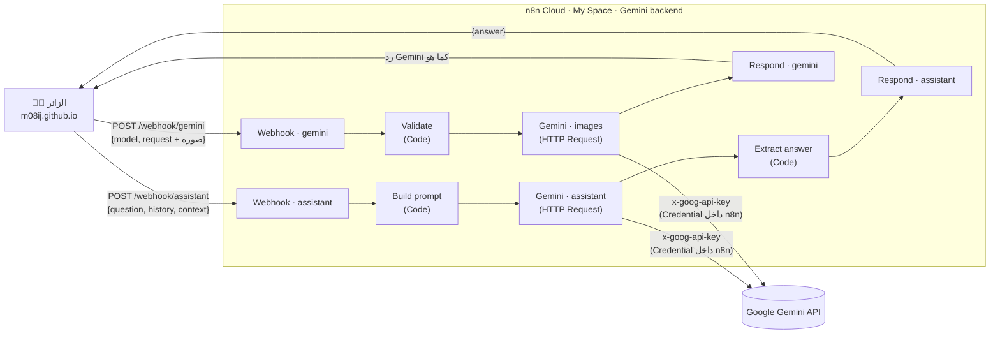
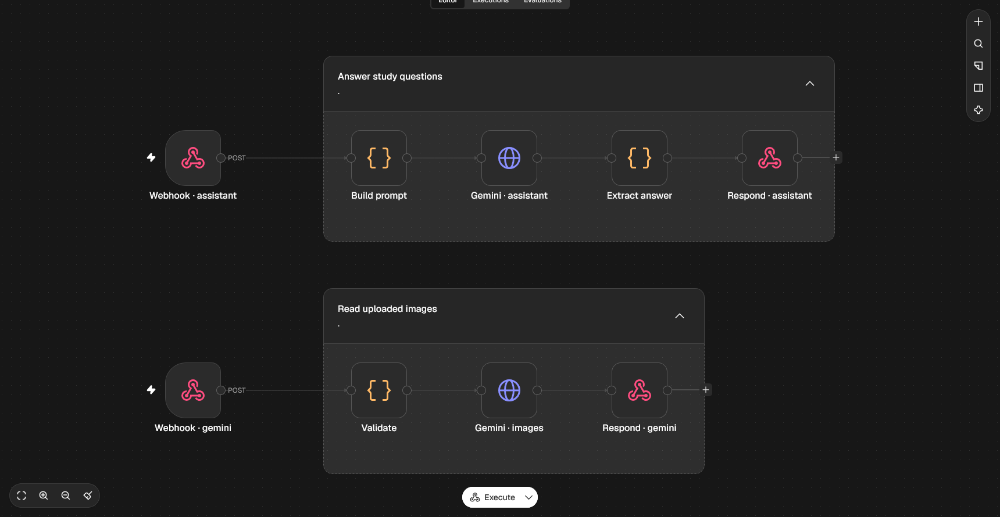

<div align="center">

# 📚 مساحتي الدراسية · Study Space

**موقع شخصي بنيته لنفسي لإدارة حياتي الجامعية — طالب هندسة حاسوب، الجامعة الهاشمية (الأردن)**

[](https://github.com/m08ij/my-study-space/actions/workflows/deploy.yml)


### 🔗 [m08ij.github.io/my-study-space](https://m08ij.github.io/my-study-space/)

</div>

### 🎬 [شاهد فيديو العرض (دقيقة)](docs/media/study-space-promo.mp4)

> هذا مشروع شخصي: صمّمته وبنيته على مقاس احتياجاتي كطالب (جدولي، موادي، امتحاناتي…). مش منتج عام، بس الرابط مفتوح وأي حد بيقدر يجرّبه — البيانات بتنحفظ على جهازه هو.

---

## ✨ شو فيه

| | |
|---|---|
| 📅 **اليوم والجدول** | المحاضرة الجاية، جدول أسبوعي بكشف التعارضات، واستيراد الجدول **من صورة** |
| 📝 **مهام وامتحانات** | إضافة سريعة بنص طبيعي («واجب برمجة بكرة»)، عدّاد للامتحانات، واستيراد الامتحانات/العلامات من صورة |
| 🎓 **المواد والخطة** | خطة الدراسة الشجرية بالمتطلبات، GPA، الحضور، العلامات |
| ✦ **مساعد دراسي ذكي** | بيجاوب من بياناتك الحقيقية وبيقترح إجراءات (إضافة مهمة/امتحان…) بعد موافقتك — **عبر n8n** |
| ⏱️ **التركيز** | بومودورو، خطة اليوم، سلسلة أيام |
| ☁️ **مزامنة** | اختيارية برمز (Supabase)، والأساس محلي ويشتغل بدون إنترنت |
| 📱 **تطبيق** | PWA قابل للتثبيت + تطبيق أندرويد مع ودجتات |

---

## 🧩 الربط مع n8n (Build · Automate · Deploy)

الموقع ستاتيك على GitHub Pages وما فيه أي مفتاح. كل طلبات الذكاء الاصطناعي بتروح لـ **workflow على n8n Cloud** وهو اللي بيحمل مفتاح Gemini — فأي زائر بيستعمل المساعد وقراءة الصور **بدون ما يحط أي مفتاح**.





| المسار | بيستقبل | بيرجّع | وين بالموقع |
|---|---|---|---|
| `POST /webhook/assistant` | `{ question, history[], context }` | `{ answer }` (Markdown + `<actions>[…]</actions>` اختياري) | زر ✦ «المساعد» — [`assistant.js`](js/assistant.js) |
| `POST /webhook/gemini` | `{ model, request }` (طلب `generateContent` كامل) | رد Gemini وحالة HTTP كما هي | استيراد الجدول/الامتحانات/العلامات من صورة — [`ocr-import.js`](js/ocr-import.js) |

**الحماية**
- مفتاح Gemini **Credential داخل n8n فقط** — مش موجود بالكود ولا بالمتصفح.
- CORS: الـWebhooks بتقبل الأصل `https://m08ij.github.io` بس.
- `Validate`: قائمة نماذج مسموحة، وحد حجم للطلب (~9MB)، ورفض الطلبات الفاضية.
- `Build prompt`: سؤال ≤800 حرف، آخر 8 رسائل، وسياق ≤14KB.
- الموقع بيطلب موافقة الطالب مرة وحدة قبل ما يبعت بياناته/صورته.
- لو Google مضغوط على نموذج (503/429/مهلة) الموقع بيجرّب نموذج ثاني لحاله.

**الملفات**
- [`n8n/workflow.json`](n8n/workflow.json) — الـworkflow نفسه (Import من n8n ← اربط Credential «Google Gemini API» ← Publish).
- [`n8n.js`](js/n8n.js) — عميل صغير (`N8n.ask` / `N8n.gemini`) مع مهلة ورسائل خطأ عربية.
- [`tools/n8n-mock.js`](tools/n8n-mock.js) — خادم n8n مُحاكى للتطوير المحلي: بيشغّل **نفس كود** عقد الـCode من `workflow.json`.

---

## 🚀 CI/CD — GitHub Actions

كل `push` على `main` ← [`.github/workflows/deploy.yml`](.github/workflows/deploy.yml):

1. **Tests** — مجموعة الاختبارات السريعة (jsdom، ~500 فحص).
2. **Build** — [`tools/build-site.js`](tools/build-site.js): بينسخ ملفات التشغيل وبيجمّعها ويصغّرها (`app.bundle.js` + `app.bundle.css`).
3. **Deploy** — GitHub Pages.

وفي [`supabase-keepalive.yml`](.github/workflows/supabase-keepalive.yml): طلب قراءة وهمي مرة باليوم عشان مشروع Supabase المجاني ما يوقف.

---

## 🛠️ التشغيل محلياً

```bash
git clone https://github.com/m08ij/my-study-space.git && cd my-study-space
node tools/compare-server.js . 8773          # http://127.0.0.1:8773  (و /__seed = بيانات طالب تجريبي)
node tools/n8n-mock.js 8791                  # n8n مُحاكى
# بالـConsole: localStorage.setItem('ss_n8n_base','http://127.0.0.1:8791/webhook')
```

```bash
cd tests && npm ci && node run-all.js quick   # الاختبارات
cd tools && npm ci && node build-site.js       # نسخة النشر بـ _site/
```

---

## 📁 البنية

```text
├── index.html · sw.js · manifest.json   الصفحة + Service Worker (لازم بالجذر) + PWA
├── js/                 السكربتات (Vanilla JS بأسلوب ES5، IIFE + window.X) — ترتيب التحميل بـindex.html
│   ├── core.js · data.js · supabase.js …   الأساس، قاعدة المواد، المزامنة
│   ├── focus.js                             الواجهة (الشاشات والتنقل)
│   ├── n8n.js · assistant.js                الربط مع n8n والمساعد
│   └── ocr-import.js · gemini-lab.js …      قراءة الصور، الخريطة، الميزات
├── css/                التنسيقات بالترتيب 01 … 12
├── fonts/ · icons/     خط Tajawal (OFL) والأيقونات
├── apk/                تطبيق أندرويد + version.json للتحديث من داخله
├── n8n/workflow.json   الـworkflow (Import بـn8n)
├── supabase/           SQL للمزامنة (RLS + دوال RPC)
├── tests/              اختبارات jsdom (+ Supabase وهمي) — node run-all.js quick
├── tools/              البناء والنشر وأدوات الفحص (شوف tools/README.md)
├── docs/               صورة الـworkflow وفيديو العرض
└── .github/workflows/  Test & Deploy + Supabase keep-alive
```

**التقنيات:** HTML5 · CSS3 · Vanilla JavaScript · PWA / Service Worker · LocalStorage + IndexedDB · Supabase · **n8n Cloud** · Google Gemini · GitHub Actions + Pages · Capacitor (Android)

---

<details>
<summary><b>English summary</b></summary>

**Study Space** is a personal university-life web app I built for myself (Computer Engineering, The Hashemite University, Jordan). It is an offline-first vanilla-JS PWA hosted on GitHub Pages.

**n8n integration.** The static site holds no API keys. Two n8n Cloud webhooks act as its backend:

- `POST /webhook/assistant` — `{question, history, context}` → *Build prompt* (Code) → *Gemini* (HTTP Request) → *Extract answer* (Code) → `{answer}`. Powers the in-app study assistant, which answers from the student's real data and can propose confirmable actions.
- `POST /webhook/gemini` — `{model, request}` → *Validate* (model allow-list, size limit) → *Gemini* → response passed through. Powers reading timetables, exams and grades from photos.

The Gemini key lives only as an n8n credential; CORS is restricted to `https://m08ij.github.io`. The workflow export is in [`n8n/workflow.json`](n8n/workflow.json), and [`tools/n8n-mock.js`](tools/n8n-mock.js) runs the same Code-node logic locally.

**CI/CD.** Every push to `main` runs the jsdom test suite, builds a minified bundle and deploys to GitHub Pages via GitHub Actions.

</details>

---

<div align="center">

### 🚀 جرّب الموقع ببيانات جاهزة

[](https://m08ij.github.io/my-study-space/?demo=1)

بيفتح الموقع بطالب تجريبي (مواد، جدول، مهام، امتحانات، ميزانية) عشان تشوفه مليان — كله بمتصفحك بس، **ولا إشي بينرفع لقاعدة البيانات**. زر «ابدأ ببياناتي» فوق بيمسحه.

**Live demo:** [m08ij.github.io/my-study-space/?demo=1](https://m08ij.github.io/my-study-space/?demo=1)

</div>
